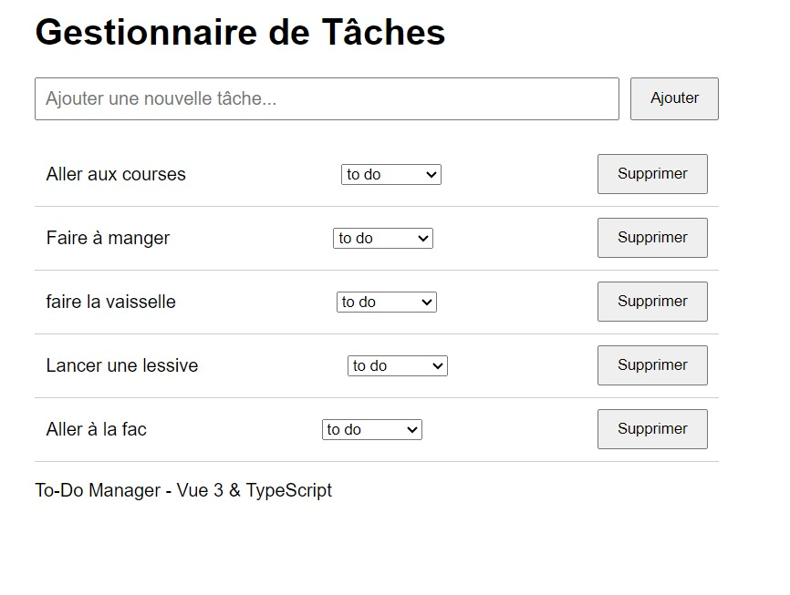
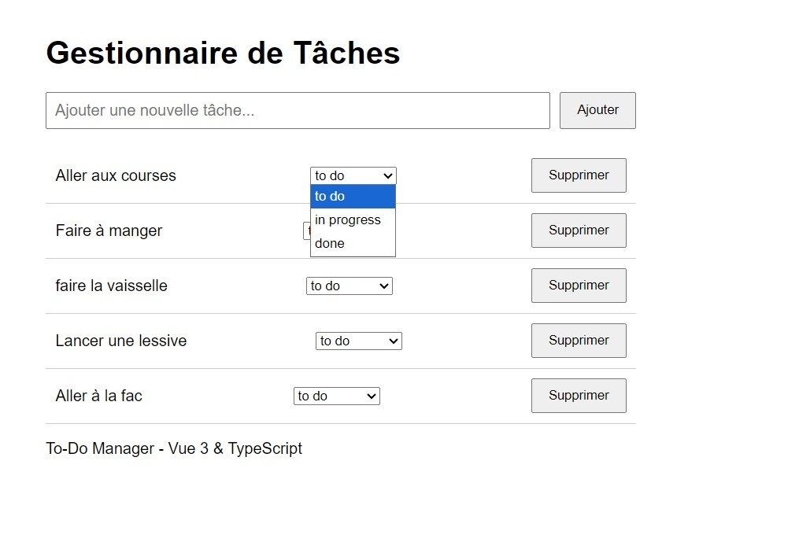

# Gestionnaire de tâches

Application web de gestion de tâches, développée avec Vue 3, TypeScript et Vite.




## Fonctionnalités

- Ajouter une tâche avec un titre (le titre est obligatoire)
- Modifier le statut d'une tâche (to do, in progress, done)
- Supprimer une tâche
- Sauvegarde automatique des tâches dans le navigateur (localStorage)

## Installation

```bash
npm install
npm run dev
```

Ouvre ensuite http://localhost:5173/ dans ton navigateur.
